# 蔵ツイン

紙の経過簿の写真から3Dの酒蔵をつくり、杜氏の判断を理由ごとタンクに残して、杜氏を目指す蔵人へ引き継ぐ。
「Built with Claude: Japan 2026」提出作品です。仕様は [SPEC.md](SPEC.md)。

> このREADMEは作成中です。検証の数字やデモ動画へのリンクは、提出までに書き足します。

公開版：https://kura-twin.netlify.app


## 画面の見方

左が3Dの蔵、右が操作の画面です。オープニングの後に「**蔵人として入る**」「**杜氏として入る**」を選びます。選んだ役割はこの端末に覚えておき、右上の「蔵人｜杜氏」でいつでも切り替えられます（`?pick=1` で選ぶ画面をもう一度出せます）。

| 役割 | 右の画面 | すること |
|---|---|---|
| **杜氏** | 判断を語る（今日の質問だけ） | 変化（品温の上げ下げ・追水・日本酒度の停滞）はプログラムのルールで検知し、Claude がその変化について判断を聞く開いた質問を1つだけ作ります。杜氏の答えが「判断メモ」としてタンクと日付に残ります。蔵人から届いた問い（「蔵人から」）が先頭に並びます。 |
| **蔵人** | 今日やること → 蔵の様子 → 杜氏に聞く | **今日の経過簿を撮る**：大きなボタンから経過簿の写真・Excel・PDF を選ぶと、Claude が読み取ります（下の「経過簿の読み取り」）。自信のない欄は拡大して読み直し、それでも分からない欄だけを「要確認」にします。保存すると「今日の経過簿：記録済み」になります。<br>**杜氏に聞く**：杜氏とのチャットの形で質問します。過去の判断メモと経過簿だけを根拠に Claude が答え、別の Claude が一文ずつ記録と照合します。答えは核心の3〜4文で、数値の経過や他のタンクの例は「詳しく見る」で開きます。 |

- **このとき杜氏はどうしてた？**：蔵人がタンクを選ぶと、そのタンクに変化があればこのボタンが出ます。押すと、タンクと状況（日付・留添何日目・変化）を添えて「杜氏に聞く」へ進みます。そのときの判断メモが無ければ、似た状況での過去の判断を答え、その日のそのタンクの本当の理由を聞けるよう「杜氏に聞いてもらう」ボタンも出します。
- **記録にない問い**：3Dの杜氏が「それは記録にないな。わしに直接聞いてみい」と言い、「杜氏に聞いてもらう」ボタンが出ます。押すと、その問いが杜氏の「判断を語る」の一覧に「蔵人から」として加わります。杜氏が答えると判断メモとして残り、次に蔵人が開いたとき、3Dの杜氏が「お前さんの問い、答えといたぞ」と語り、「杜氏に聞く」で答えを見られます。同じことを聞かれたときは、その判断メモから答えます。

| | | |
|---|---|---|
| 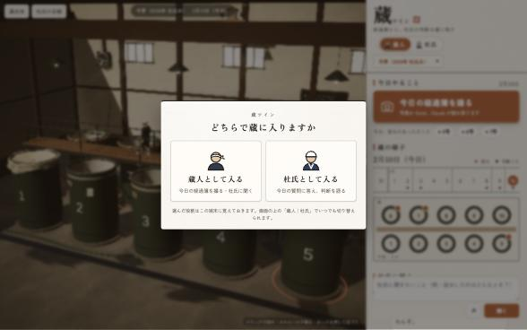 | 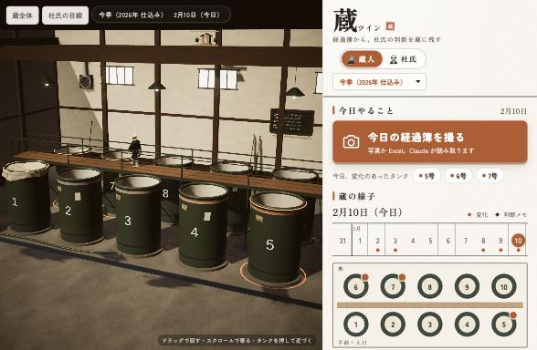 | 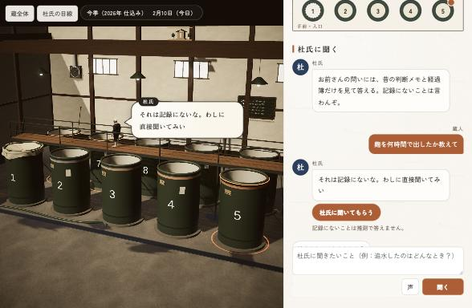 |
| 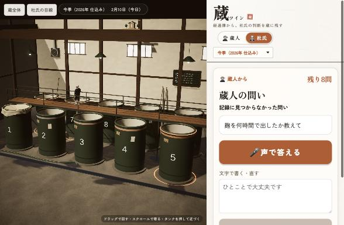 | 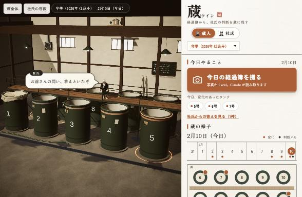 | 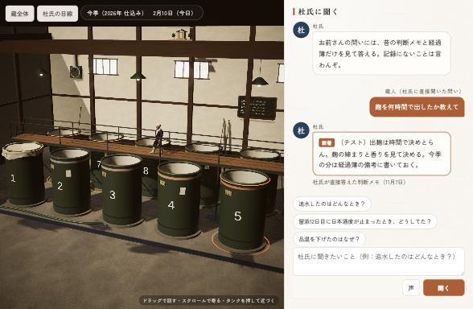 |

- 上の**季**は「今季（2026年 仕込み）」と「過去の仕込み（2025年）」。仕込みの記録は毎年積み重なります。
- **暦の帯**で日を選びます。変化のあった日には柿色の点、判断メモのある日には墨の印が付きます。
- **タンクの見取り図**は3Dの蔵と同じ並び（奥に6〜10号、足場をはさんで手前に1〜5号）を上から見た形です。変化のあるタンクには柿色の印、選んだタンクは縁が光ります。押す（または3Dのタンクを押す）と、そのタンクの記録の図と、Claude による「今日の様子」の短い要約が出ます。
- 右の画面は和紙の地に墨の細い線。作品名には落款を添えています。**今季は暖かい色、過去の仕込みや判断メモを見ているあいだは藍色**になり、左の3Dの光と揃います。

### 3Dの蔵（Unity 6・URP・WebGL）

- **読み込み中**：墨の細い線で経過簿の罫線が引かれ、読み込みの進み具合に合わせて数字が1行ずつ書き込まれます（`?loader=1` でこの画面だけを見られます）。
- **オープニング**（開くたびに、6〜8秒）：蔵の大戸が開き、朝の光が差し込む中をカメラが入っていくと、足場の上の杜氏が振り向いて「よう来たな」。そのまま蔵全体の視点に落ち着きます。画面に触ればすぐ飛ばせます。大戸と表の壁はその場で組み立てるので、3Dのファイルはほとんど増えません。

- 日付に合わせて液面と品温の帯が動き、変化のあったタンクの縁と足元が控えめに光ります。
- **杜氏の案内**：蔵人の質問に答えが出ると、杜氏（Tripo で生成）が足場を歩いて根拠のタンクの前まで行き、振り向いて吹き出しで語ります。
- **時を巻き戻す**：過去の仕込みの記録や判断メモを開くと、朝の光に変わり、液面と品温が当時の状態へ戻ります。
- **蔵の空気**：高窓からの光の筋。発酵中のタンクの液面からは、淡い金色の「香りの粒」が立ち上る（醪は10℃前後で湯気は立たないので、杜氏が香りで見る発酵を演出として見せる。量は状ぼうの盛りに合わせる）。もろみの表面には小さな泡が浮かんでは弾ける。
- **自由に動かせる**：ドラッグで回す・スクロール（ピンチ）で寄る・右ドラッグ（2本指）で動かす・タンクを押すとそこへ寄る。「蔵全体」「杜氏の目線」のボタンで自動のカメラに戻ります。スマホのタッチでも動きます。

| | |
|---|---|
|  |  |
|  |  |

設計の原則：Claude は醸造の判断をしません。最終判断は常に杜氏です。蔵の入力は増やしません。

## 経過簿の読み取り

### 対応している形式（写真・Excel・PDF）

| 形式 | 読み方 |
|---|---|
| **写真** | 手書きの経過簿をスマホで撮る。Claude（Opus）が見出しと値を書かれたとおりに読み、自信のない欄は拡大して読み直す。それでも決まらない欄と不自然な数値だけを「要確認」にし、人が確認・修正してから保存する |
| **PDF** | スキャンした用紙や、ほかの仕組みから書き出した表。ページごとに画像にして写真と同じように読み、見出しの名前でそろえて1つの表にする（複数ページ可） |
| **Excel** | パソコンでつけている経過簿。値は Claude に書き写させずセルの値をそのまま使い、見出しの位置と意味だけを Claude が推定する |

蔵ごとに書式が違うので、次の違いに対応しています。
- 日付が横に並ぶ表／縦に並ぶ表
- 見出しの名前の違い（ボーメ→BMD・Bé、日本酒度→SMV、アルコール分→アル分、日順→醪日数、状ぼう→泡・状態 など）
- 項目の順番の違い、一部の項目が無い書式
- 1枚に複数のタンクを書く書式（タンクの列でタンクごとに分ける）
- タンク番号は、読んだ日付と日順を蔵の記録と突き合わせ、合わなければ「要確認」にして合うタンクを示す（タンク番号の1字の読み違いで、記録が別のタンクに入らないように）

### 初めての書式は確認して覚える

1. 初めての書式を読むと、Claude が見出しごとに「どの項目にあたるか」を推定する。
2. 自信のない見出しだけ、蔵人に「この列は **品温** ですか？」と聞く。見出しと実際の値（7.9・8.5…）を一緒に見せ、**はい／ちがう** の大きなボタンで答える。ちがうときは、項目の名前の大きなボタンから選ぶ。
3. 答えた対応を、その蔵の書式としてこの端末に覚える。**2回目からは聞かずに読む**（写真で覚えた書式は Excel・PDF でも使う）。見出しが少し増えた表は、覚えている見出しはそのまま、新しい見出しだけを聞いて書式に足す。
4. 取り込み画面の「覚えた書式」で、見出しごとの対応を見直し・直し・忘れられる。

| | | |
|---|---|---|
| 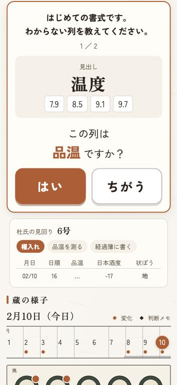 | 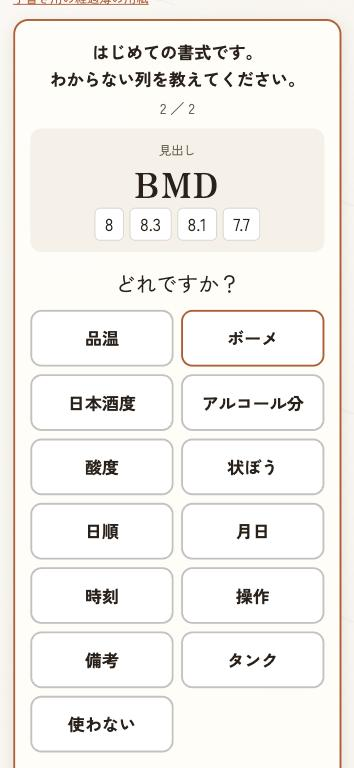 | 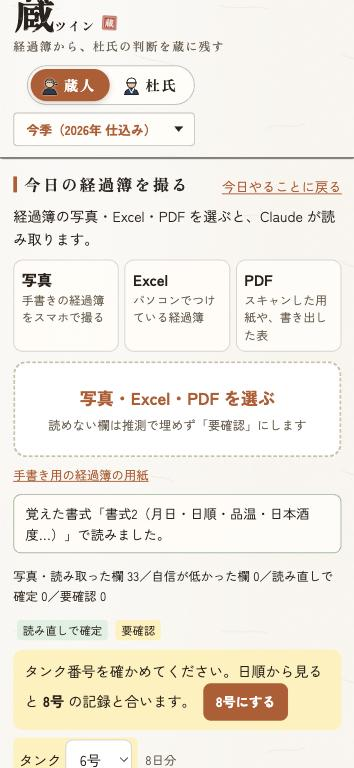 |
| 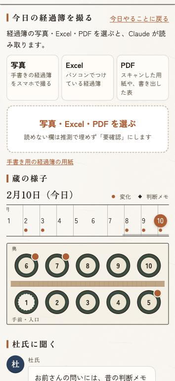 | 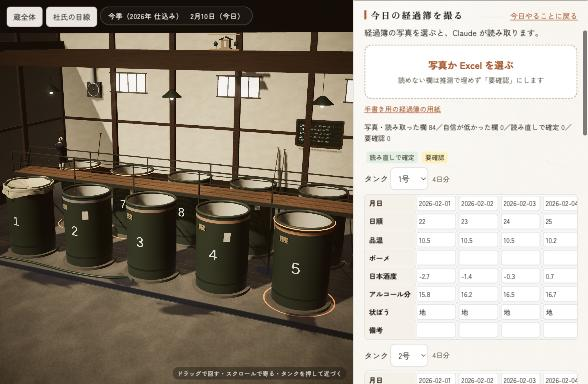 | 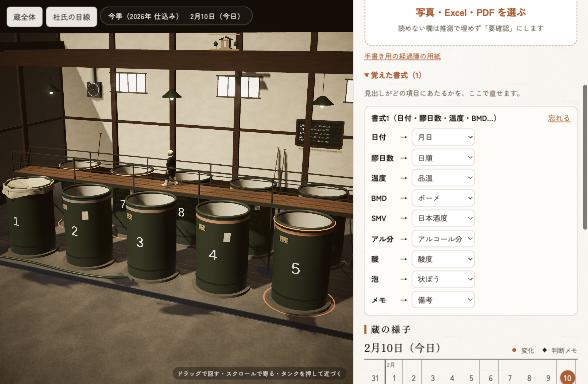 |

### 試した書式と正解率

書式の違う経過簿を6種類（標準／日付が縦／項目名が違う〈日付・醪日数・温度・BMD・SMV・アル分・酸・泡・メモ〉／項目の順番が違う／一部の項目が無い／複数のタンクを1枚に）つくり、それぞれを手書き風の写真・悪条件の写真（暗い・斜め・ぶれ・低画素）・限界の写真（さらにぶれて長い辺 1000px）・スキャンした PDF・Excel で読んで、正解と比べました（値はすべて架空のデモデータ。用紙と正解は [web/eval/sheets](web/eval/sheets)、数え方と測り直し方は [web/eval/README.md](web/eval/README.md)）。

| 書式 | 手書き風の写真 | 悪条件の写真 | 限界の写真 | スキャンした PDF | Excel | 確認した見出し |
|---|---|---|---|---|---|---|
| 標準（用紙どおり・日付が横） | 100.0%（67/67） | 100.0%（67/67） | 97.0%（65/67・要確認1・誤り1） | 100.0%（67/67） | 100.0%（67/67） | なし |
| 日付が縦に並ぶ | 100.0%（59/59） | 100.0%（59/59） | 91.5%（54/59・要確認5） | 100.0%（59/59） | 100.0%（59/59） | なし |
| 項目名が違う（BMD・SMV・アル分 など） | 100.0%（55/55） | 100.0%（55/55） | 92.7%（51/55・要確認4） | 100.0%（55/55） | 100.0%（55/55） | 温度（手書き風の写真・Excel・限界の写真）、BMD |
| 項目の順番が違う | 100.0%（63/63） | 100.0%（63/63） | 90.5%（57/63・要確認6） | 100.0%（63/63） | 100.0%（63/63） | なし |
| 一部の項目が無い | 100.0%（34/34） | 100.0%（34/34） | 94.1%（32/34・要確認2） | 100.0%（34/34） | 100.0%（34/34） | なし |
| 複数のタンクを1枚に | 100.0%（72/72） | 100.0%（72/72） | 94.4%（68/72・要確認4） | 100.0%（72/72） | 100.0%（72/72） | 状態（Excel） |
| **合計** | **100.0%**（350/350） | **100.0%**（350/350） | **93.4%**（327/350・要確認22・誤り1） | **100.0%**（350/350） | **100.0%**（350/350） | |

- 写真（ふつう・悪条件）・PDF・Excel は 6書式とも全欄正解。見出しの対応の誤りも 0。「温度」と「BMD」（多くの蔵では「ボーメ×醪日数」の別の値）は、Claude が決めつけずに確認に回した。
- 限界の写真では、読めない欄を推測で埋めず「要確認」にした（350欄のうち 22欄）。1回目は手書きのタンク番号「8」を「5」と読む誤りがあり、蔵の記録との突き合わせを加えて止めた。2回目に残った誤りは備考の「切れ鈍い」→「切れ良い」の1欄で、文字の欄は1字でも迷えば「要確認」にするよう直した（この直しは、Claude API の利用額の上限に達したため、まだ測り直していない）。
- **限界**：手書きは手書き風の書体で描いたもので、本物の手書きより読みやすい。本物の経過簿では正解率は下がるはずです。読めない欄は推測で埋めない作りなので、誤りより「要確認」が増える方向に働きます。

## 構成

| 場所 | 中身 |
|---|---|
| `web/` | 操作画面（Vite＋素のJS）、Netlify Functions（Claude API はサーバー側だけで呼ぶ）、デモデータ、検知ルール |
| `unity/KuraTwin/` | 3Dの蔵。`Kura` メニュー（またはバッチ実行）でシーンを組み立て、WebGL で `web/public/unity/` に書き出す |
| `web/eval/` | 読み取りの検証：書式の違う経過簿（写真・PDF・Excel）と正解、正解率を測るページ（開発中だけ使う） |
| `docs/screenshots/` | 作り直す前（`before-*`）と後（`after-*`・`effects-*`）の画面 |
| `print/` | 手書き用の経過簿の用紙（PDF） |

## 動かし方

```bash
cd web
npm install
cp .env.example .env   # ANTHROPIC_API_KEY を書く
npm run dev            # http://localhost:8888
npm test
```

## 杜氏のキャラクター（Tripo で生成）

3Dの蔵に立つ杜氏は、[Tripo](https://www.tripo3d.ai/) の API で、**文章だけから生成**しました（実在の人物の写真は使っていません）。

- 生成：文章から3D（`v3.1-20260211`、テクスチャ付き・ポリゴンを抑える）
- 骨入れ：Tripo の自動リグ（人型、`v1.0-20240301`）
- 動き：Tripo の「立って待つ」「うなずく」。うなずきは Unity 側で首と頭だけに効かせ、話している間だけ重ねます
- 手順：[`web/scripts/tripo/toji.mjs`](web/scripts/tripo/toji.mjs)

**モデルのファイル（FBX・画像）はこのリポジトリに含めていません**（`unity/KuraTwin/Assets/Toji/` は `.gitignore` 済み）。
自分で作り直すときは、`web/.env` に `TRIPO_API_KEY` を書き、`web/` で次を順に実行してから、Unity の `Kura/1. シーンを用意` を実行します。
モデルが無い場合、杜氏は仮の人形のまま表示されます。

```bash
node --env-file=.env scripts/tripo/toji.mjs generate
node --env-file=.env scripts/tripo/toji.mjs rigcheck
node --env-file=.env scripts/tripo/toji.mjs rig
node --env-file=.env scripts/tripo/toji.mjs animate
```

公開している Web 版の3D（`web/public/unity/`）には、生成した杜氏が含まれます。

## 公開版の守り

知らない人に大量に呼ばれないよう、Claude を呼ぶ処理には回数の上限があります（同じ利用者から1分に40回・1日300回、全員で1日1,500回。蔵人の質問と経過簿の読み取りは Netlify の制限でどちらも1分に8回。PDF は1ページずつ読む）。上限に達すると、画面に「待ってから再実行」と出ます。Claude Console で決めた利用額の上限に達したときは、「いまは Claude を使えません」と出ます。

## データについて

デモの蔵・経過簿・判断メモはすべて架空です。実在の蔵のデータは含みません。

## Claude Code の使い方

この作品は Claude Code と一緒に作りました。[CLAUDE.md](CLAUDE.md) に設計の原則とAPIキーの扱いを書き、フックで APIキー（Anthropic・Tripo）を含むコミットを止めています。経過簿の用語は Skill（`.claude/skills/kura-terms`）にまとめています。
