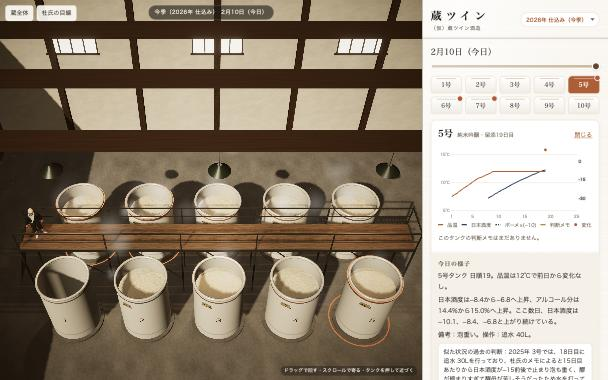
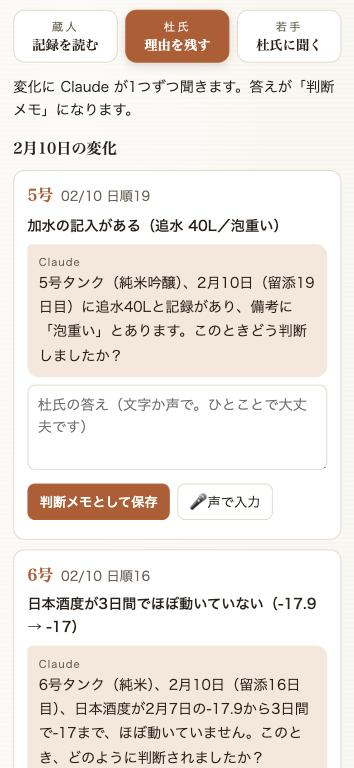
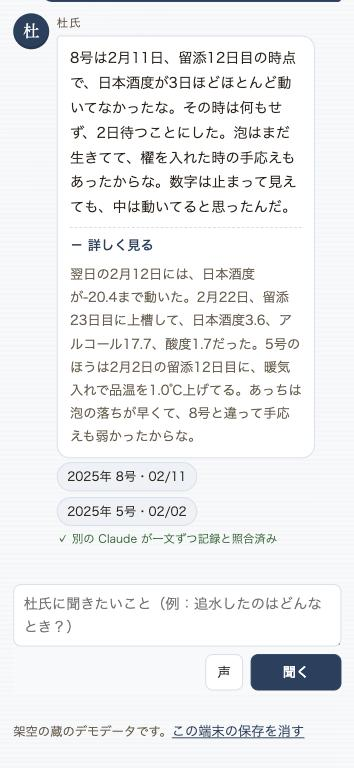
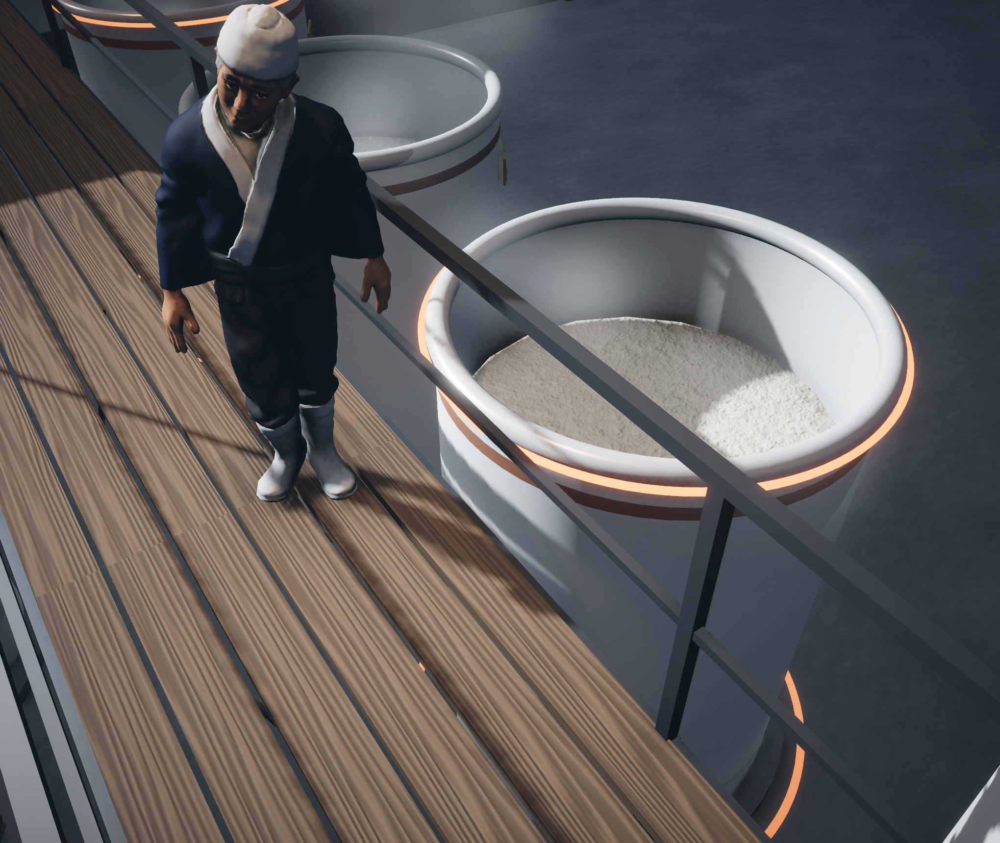
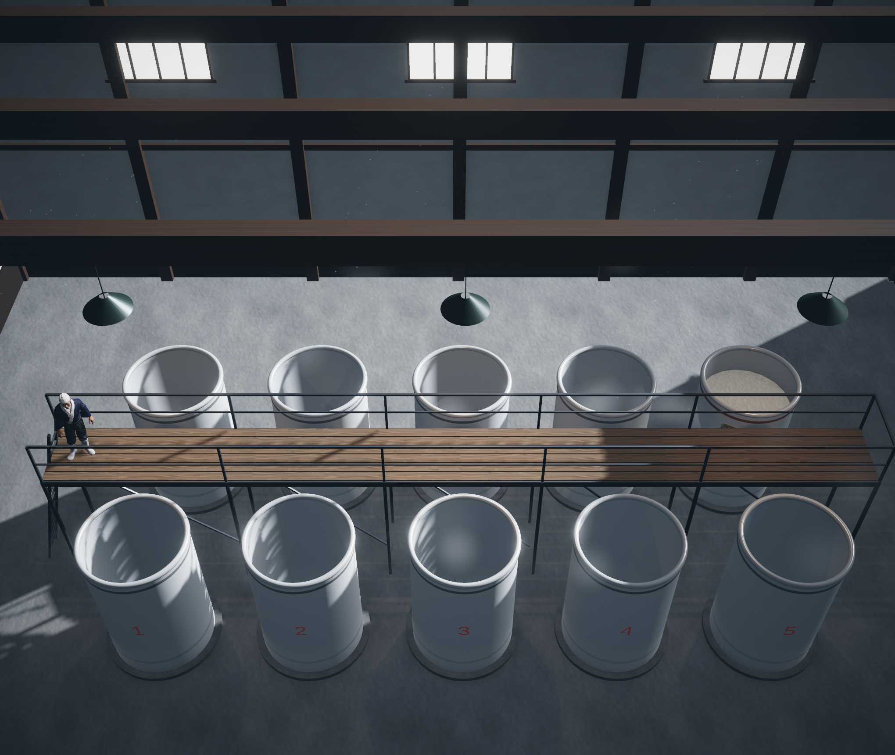

# 蔵ツイン

紙の経過簿の写真から3Dの酒蔵をつくり、杜氏の判断を理由ごとタンクに残して、杜氏を目指す蔵人へ引き継ぐ。
「Built with Claude: Japan 2026」提出作品です。仕様は [SPEC.md](SPEC.md)。

> このREADMEは作成中です。検証の数字やデモ動画へのリンクは、提出までに書き足します。

公開版：https://kura-twin.netlify.app



## 画面の見方

左が3Dの蔵、右が操作の画面です。右は**使う人ごとに3つ**に分かれています（タブの上の段に、使う人の名前と小さな絵：蔵人は手ぬぐい、杜氏は白い作業帽）。

| タブ | 使う人 | すること |
|---|---|---|
| **蔵人：経過簿を撮る** | 蔵人 | 手書きの経過簿の写真（またはExcel）を選ぶと、Claude が読み取ります。自信のない欄は拡大して読み直し、それでも分からない欄だけを「要確認」にします。 |
| **杜氏：判断を語る** | 杜氏 | 変化（品温の上げ下げ・追水・日本酒度の停滞）はプログラムのルールで検知し、Claude がその変化について判断を聞く開いた質問を1つだけ作ります。杜氏の答えが「判断メモ」としてタンクと日付に残ります。 |
| **蔵人：杜氏に聞く** | 杜氏を目指す蔵人 | 杜氏とのチャットの形で質問します。過去の判断メモと経過簿だけを根拠に Claude が答え、別の Claude が一文ずつ記録と照合します。答えは核心の3〜4文で、数値の経過や他のタンクの例は「詳しく見る」で開きます。記録に無ければ「記録が見つかりません」と答えます。 |

- 上の**季**は「今季（2026年 仕込み）」と「過去の仕込み（2025年）」。仕込みの記録は毎年積み重なります。
- **暦の帯**で日を選びます。変化のあった日には柿色の点、判断メモのある日には墨の印が付きます。
- **タンクの見取り図**は3Dの蔵と同じ並び（奥に6〜10号、足場をはさんで手前に1〜5号）を上から見た形です。変化のあるタンクには柿色の印、選んだタンクは縁が光ります。押す（または3Dのタンクを押す）と、そのタンクの記録の図と、Claude による「今日の様子」の短い要約が出ます。
- 右の画面は和紙の地に墨の細い線。作品名には落款を添えています。**今季は暖かい色、過去の仕込みや判断メモを見ているあいだは藍色**になり、左の3Dの光と揃います。

### 3Dの蔵（Unity 6・URP・WebGL）

- **読み込み中**：墨の細い線で経過簿の罫線が引かれ、読み込みの進み具合に合わせて数字が1行ずつ書き込まれます（`?loader=1` でこの画面だけを見られます）。
- **オープニング**（初めて開いたときだけ、6〜8秒）：蔵の大戸が開き、朝の光が差し込む中をカメラが入っていくと、足場の上の杜氏が振り向いて「よう来たな」。そのまま蔵全体の視点に落ち着きます。画面に触ればすぐ飛ばせます（`?opening=1` で何度でも再生）。大戸と表の壁はその場で組み立てるので、3Dのファイルはほとんど増えません。

- 日付に合わせて液面と品温の帯が動き、変化のあったタンクの縁と足元が控えめに光ります。
- **杜氏の案内**：蔵人の質問に答えが出ると、杜氏（Tripo で生成）が足場を歩いて根拠のタンクの前まで行き、振り向いて吹き出しで語ります。
- **時を巻き戻す**：過去の仕込みの記録や判断メモを開くと、朝の光に変わり、液面と品温が当時の状態へ戻ります。
- **蔵の空気**：高窓からの光の筋。発酵中のタンクの液面からは、淡い金色の「香りの粒」が立ち上る（醪は10℃前後で湯気は立たないので、杜氏が香りで見る発酵を演出として見せる。量は状ぼうの盛りに合わせる）。もろみの表面には小さな泡が浮かんでは弾ける。
- **自由に動かせる**：ドラッグで回す・スクロール（ピンチ）で寄る・右ドラッグ（2本指）で動かす・タンクを押すとそこへ寄る。「蔵全体」「杜氏の目線」のボタンで自動のカメラに戻ります。スマホのタッチでも動きます。

| | |
|---|---|
|  |  |
|  |  |

設計の原則：Claude は醸造の判断をしません。最終判断は常に杜氏です。蔵の入力は増やしません。

## 構成

| 場所 | 中身 |
|---|---|
| `web/` | 操作画面（Vite＋素のJS）、Netlify Functions（Claude API はサーバー側だけで呼ぶ）、デモデータ、検知ルール |
| `unity/KuraTwin/` | 3Dの蔵。`Kura` メニュー（またはバッチ実行）でシーンを組み立て、WebGL で `web/public/unity/` に書き出す |
| `docs/screenshots/` | 作り直す前（`before-*`）と後（`after-*`・`effects-*`）の画面 |
| `print/` | 手書き用の経過簿の用紙（PDF） |

## 動かし方

```bash
cd web
npm install
cp .env.example .env   # ANTHROPIC_API_KEY を書く
npm run dev            # http://localhost:8888
npm test
```

## 杜氏のキャラクター（Tripo で生成）

3Dの蔵に立つ杜氏は、[Tripo](https://www.tripo3d.ai/) の API で、**文章だけから生成**しました（実在の人物の写真は使っていません）。

- 生成：文章から3D（`v3.1-20260211`、テクスチャ付き・ポリゴンを抑える）
- 骨入れ：Tripo の自動リグ（人型、`v1.0-20240301`）
- 動き：Tripo の「立って待つ」「うなずく」。うなずきは Unity 側で首と頭だけに効かせ、話している間だけ重ねます
- 手順：[`web/scripts/tripo/toji.mjs`](web/scripts/tripo/toji.mjs)

**モデルのファイル（FBX・画像）はこのリポジトリに含めていません**（`unity/KuraTwin/Assets/Toji/` は `.gitignore` 済み）。
自分で作り直すときは、`web/.env` に `TRIPO_API_KEY` を書き、`web/` で次を順に実行してから、Unity の `Kura/1. シーンを用意` を実行します。
モデルが無い場合、杜氏は仮の人形のまま表示されます。

```bash
node --env-file=.env scripts/tripo/toji.mjs generate
node --env-file=.env scripts/tripo/toji.mjs rigcheck
node --env-file=.env scripts/tripo/toji.mjs rig
node --env-file=.env scripts/tripo/toji.mjs animate
```

公開している Web 版の3D（`web/public/unity/`）には、生成した杜氏が含まれます。

## 公開版の守り

知らない人に大量に呼ばれないよう、Claude を呼ぶ処理には回数の上限があります（同じ利用者から1分に40回・1日300回、全員で1日1,500回。蔵人の質問と経過簿の読み取りは Netlify の制限で1分に8回・5回）。上限に達すると、画面に「待ってから再実行」と出ます。

## データについて

デモの蔵・経過簿・判断メモはすべて架空です。実在の蔵のデータは含みません。

## Claude Code の使い方

この作品は Claude Code と一緒に作りました。[CLAUDE.md](CLAUDE.md) に設計の原則とAPIキーの扱いを書き、フックで APIキー（Anthropic・Tripo）を含むコミットを止めています。経過簿の用語は Skill（`.claude/skills/kura-terms`）にまとめています。
