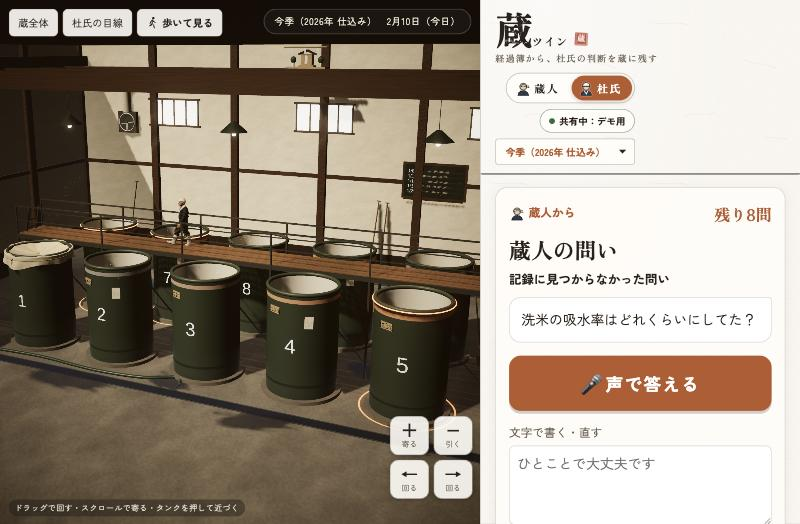
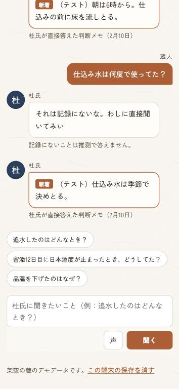

# 蔵ツイン

紙の経過簿の写真から3Dの酒蔵をつくり、杜氏の判断を理由ごとタンクに残して、杜氏を目指す蔵人へ引き継ぐ。
「Built with Claude: Japan 2026」提出作品です。仕様は [SPEC.md](SPEC.md)。

> 検証の数字は下の「検証」にまとめています。

公開版：https://kura-twin.netlify.app
デモ動画（3分以内）：（YouTube の URL を公開後に記載します）


## 画面の見方

左が3Dの蔵、右が操作の画面です。読み込みとオープニングのあいだは3Dを画面いっぱいに見せ、オープニングが終わると右（スマホでは下）の操作画面が静かに現れます。初めて開いたときは、続けて**杜氏の案内**（下）があり、そのあと「**蔵人として入る**」「**杜氏として入る**」を選びます。選んだ役割はこの端末に覚えておき、右上の「蔵人｜杜氏」でいつでも切り替えられます（`?pick=1` で選ぶ画面をもう一度出せます）。

| 役割 | 右の画面 | すること |
|---|---|---|
| **杜氏** | 判断を語る（今日の質問だけ） | 変化（品温の上げ下げ・追水・日本酒度の停滞）はプログラムのルールで検知し、Claude がその変化について判断を聞く開いた質問を1つだけ作ります。杜氏の答えが「判断メモ」としてタンクと日付に残ります。蔵人から届いた問い（「蔵人から」）が先頭に並びます。 |
| **蔵人** | 今日やること → 蔵の様子 → 杜氏に聞く | **今日の経過簿を撮る**：大きなボタンから経過簿の写真・Excel・PDF を選ぶと、Claude が読み取ります（下の「経過簿の読み取り」）。自信のない欄は拡大して読み直し、それでも分からない欄だけを「要確認」にします。保存すると「今日の経過簿：記録済み」になります。<br>**杜氏に聞く**：杜氏とのチャットの形で質問します。過去の判断メモと経過簿だけを根拠に Claude が答え、別の Claude が一文ずつ記録と照合します。答えは核心の3〜4文で、数値の経過や他のタンクの例は「詳しく見る」で開きます。 |

- **杜氏の案内（初めて開いたとき）**：3Dの杜氏が吹き出しで3つの場面を案内し、カメラと右の画面の該当箇所（光らせ、ほかを淡くする）で示します。①経過簿を撮るとタンクに反映される（「今日の経過簿を撮る」）②品温を下げた日などは Claude が杜氏に理由を聞きに来て、杜氏は声で一言答える（杜氏の「判断を語る」。杜氏が7号の前まで歩いて語る）③迷ったら杜氏に聞く（「杜氏に聞く」）。全体で約30〜40秒。画面に触るか「飛ばす」でいつでも終わり、2回目からは出ません。右の画面の上の「**案内を見る**」でいつでも見直せます。決めた台詞と画面の動きだけで、Claude は呼びません。
- **このとき杜氏はどうしてた？**：蔵人がタンクを選ぶと、そのタンクに変化があればこのボタンが出ます。押すと、タンクと状況（日付・留添何日目・変化）を添えて「杜氏に聞く」へ進みます。そのときの判断メモが無ければ、似た状況での過去の判断を答え、その日のそのタンクの本当の理由を聞けるよう「杜氏に聞いてもらう」ボタンも出します。
- **記録にない問い**：3Dの杜氏が「それは記録にないな。わしに直接聞いてみい」と言い、「杜氏に聞いてもらう」ボタンが出ます。押すと、その問いが杜氏の「判断を語る」の一覧に「蔵人から」として加わります。杜氏が答えると判断メモとして残り、次に蔵人が開いたとき、3Dの杜氏が「お前さんの問い、答えといたぞ」と語り、「杜氏に聞く」で答えを見られます。同じことを聞かれたときは、その判断メモから答えます。

| | | |
|---|---|---|
|  |  |  |
|  |  |  |

- 上の**季**は「今季（2026年 仕込み）」と「過去の仕込み（2025年）」。仕込みの記録は毎年積み重なります。
- **暦の帯**で日を選びます。変化のあった日には柿色の点、判断メモのある日には墨の印が付きます。
- **タンクの見取り図**は3Dの蔵と同じ並び（奥に6〜10号、足場をはさんで手前に1〜5号）を上から見た形です。変化のあるタンクには柿色の印、選んだタンクは縁が光ります。押す（または3Dのタンクを押す）と、そのタンクの記録の図と、Claude による「今日の様子」の短い要約が出ます。
- 右の画面は和紙の地に墨の細い線。作品名には落款を添えています。**今季は暖かい色、過去の仕込みや判断メモを見ているあいだは藍色**になり、左の3Dの光と揃います。

### 3Dの蔵（Unity 6・URP・WebGL）

- **読み込み中**：墨の細い線で経過簿の罫線が引かれ、読み込みの進み具合に合わせて数字が1行ずつ書き込まれます（`?loader=1` でこの画面だけを見られます）。
- **オープニング**（開くたびに、6〜8秒）：蔵の大戸が開き、朝の光が差し込む中をカメラが入っていくと、足場の上の杜氏が振り向いて「よう来たな」。そのまま蔵全体の視点に落ち着きます。画面に触ればすぐ飛ばせます。大戸と表の壁はその場で組み立てるので、3Dのファイルはほとんど増えません。

- 日付に合わせて液面と品温の帯が動き、変化のあったタンクの縁と足元が控えめに光ります。
- **杜氏の案内**：蔵人の質問に答えが出ると、杜氏（Tripo で生成）が足場を歩いて根拠のタンクの前まで行き、振り向いて吹き出しで語ります。
- **時を巻き戻す**：過去の仕込みの記録や判断メモを開くと、朝の光に変わり、液面と品温が当時の状態へ戻ります。
- **蔵の空気**：高窓からの光の筋。発酵中のタンクの液面からは、淡い金色の「香りの粒」が立ち上る（醪は10℃前後で湯気は立たないので、杜氏が香りで見る発酵を演出として見せる。量は状ぼうの盛りに合わせる）。もろみの表面には小さな泡が浮かんでは弾ける。
- **自由に動かせる**：ドラッグで回す・スクロール（ピンチ）で寄る・右ドラッグ（2本指）で動かす・タンクを押すとそこへ寄る。「蔵全体」「杜氏の目線」のボタンで自動のカメラに戻ります。指の細かい操作が苦手な人のために、右下に大きなボタン（**＋ 寄る・− 引く・← → 回る**。押し続けると続けて動く）もあります。
- **歩いて見る**：左上の「歩いて見る」で、人の目の高さで蔵の中を歩けます。スマホは左下のつまみを倒した向きに歩き、画面をなぞって見回す。パソコンは矢印キー（WASD）で歩き、ドラッグで見回す。床と足場の上だけを歩き、壁・タンク・床の物・手すりはすり抜けません。足場の左端のはしごに向かって進むと足場へ上がり、足場の左端から戻ると下ります。「戻る」で今の操作に戻り、杜氏の案内が始まったときも自動で戻ります。

| | |
|---|---|
|  |  |
|  |  |

設計の原則：Claude は醸造の判断をしません。最終判断は常に杜氏です。蔵の入力は増やしません。

## 経過簿の読み取り

### 対応している形式（写真・Excel・PDF）

| 形式 | 読み方 |
|---|---|
| **写真** | 手書きの経過簿をスマホで撮る。Claude（Opus）が見出しと値を書かれたとおりに読み、自信のない欄は拡大して読み直す。それでも決まらない欄と不自然な数値だけを「要確認」にし、人が確認・修正してから保存する |
| **PDF** | スキャンした用紙や、ほかの仕組みから書き出した表。ページごとに画像にして写真と同じように読み、見出しの名前でそろえて1つの表にする（複数ページ可） |
| **Excel** | パソコンでつけている経過簿。値は Claude に書き写させずセルの値をそのまま使い、見出しの位置と意味だけを Claude が推定する |

蔵ごとに書式が違うので、次の違いに対応しています。
- 日付が横に並ぶ表／縦に並ぶ表
- 見出しの名前の違い（ボーメ→BMD・Bé、日本酒度→SMV、アルコール分→アル分、日順→醪日数、状ぼう→泡・状態 など）
- 項目の順番の違い、一部の項目が無い書式
- 1枚に複数のタンクを書く書式（タンクの列でタンクごとに分ける）
- タンク番号は、読んだ日付と日順を蔵の記録と突き合わせ、合わなければ「要確認」にして合うタンクを示す（タンク番号の1字の読み違いで、記録が別のタンクに入らないように）

### 初めての書式は確認して覚える

1. 初めての書式を読むと、Claude が見出しごとに「どの項目にあたるか」を推定する。
2. 自信のない見出しだけ、蔵人に「この列は **品温** ですか？」と聞く。見出しと実際の値（7.9・8.5…）を一緒に見せ、**はい／ちがう** の大きなボタンで答える。ちがうときは、項目の名前の大きなボタンから選ぶ。
3. 答えた対応を、その蔵の書式としてこの端末に覚える。**2回目からは聞かずに読む**（写真で覚えた書式は Excel・PDF でも使う）。見出しが少し増えた表は、覚えている見出しはそのまま、新しい見出しだけを聞いて書式に足す。
4. 取り込み画面の「覚えた書式」で、見出しごとの対応を見直し・直し・忘れられる。

| | | |
|---|---|---|
|  |  |  |
|  |  |  |

### 試した書式と正解率

書式の違う経過簿を6種類（標準／日付が縦／項目名が違う〈日付・醪日数・温度・BMD・SMV・アル分・酸・泡・メモ〉／項目の順番が違う／一部の項目が無い／複数のタンクを1枚に）つくり、それぞれを手書き風の写真・悪条件の写真（暗い・斜め・ぶれ・低画素）・限界の写真（さらにぶれて長い辺 1000px）・スキャンした PDF・Excel で読んで、正解と比べました（値はすべて架空のデモデータ。用紙と正解は [web/eval/sheets](web/eval/sheets)、数え方と測り直し方は [web/eval/README.md](web/eval/README.md)）。

| 書式 | 手書き風の写真 | 悪条件の写真 | 限界の写真 | スキャンした PDF | Excel | 確認した見出し |
|---|---|---|---|---|---|---|
| 標準（用紙どおり・日付が横） | 100.0%（67/67） | 100.0%（67/67） | 91.0%（61/67・要確認6） | 100.0%（67/67） | 100.0%（67/67） | なし |
| 日付が縦に並ぶ | 100.0%（59/59） | 100.0%（59/59） | 89.8%（53/59・要確認6） | 100.0%（59/59） | 100.0%（59/59） | なし |
| 項目名が違う（BMD・SMV・アル分 など） | 100.0%（55/55） | 100.0%（55/55） | 94.5%（52/55・要確認3） | 100.0%（55/55） | 100.0%（55/55） | 温度（手書き風の写真・Excel・限界の写真）、BMD |
| 項目の順番が違う | 100.0%（63/63） | 100.0%（63/63） | 93.7%（59/63・要確認4） | 100.0%（63/63） | 100.0%（63/63） | なし |
| 一部の項目が無い | 100.0%（34/34） | 100.0%（34/34） | 85.3%（29/34・要確認5） | 100.0%（34/34） | 100.0%（34/34） | なし |
| 複数のタンクを1枚に | 100.0%（72/72） | 100.0%（72/72） | 94.4%（68/72・要確認4） | 100.0%（72/72） | 100.0%（72/72） | 状態（Excel） |
| **合計** | **100.0%**（350/350） | **100.0%**（350/350） | **92.0%**（322/350・要確認28） | **100.0%**（350/350） | **100.0%**（350/350） | |

- 写真（ふつう・悪条件）・PDF・Excel は 6書式とも全欄正解。見出しの対応の誤りも 0。「温度」と「BMD」（多くの蔵では「ボーメ×醪日数」の別の値）は、Claude が決めつけずに確認に回した。
- 限界の写真も**誤り 0**。読めない欄は推測で埋めず「要確認」にした（350欄のうち 28欄）。
- 測る中で見つけて直した誤り：手書きのタンク番号「8」を「5」と読む（蔵の記録の日順と突き合わせて「要確認」にし、合うタンクを示す）、備考の「切れ鈍い」を「切れ良い」と読む（文字の欄は1字でも迷えば「要確認」）、月日が読めない日（日順と記録から月日を埋めて「要確認」に）。詳しくは [web/eval/README.md](web/eval/README.md)。
- **限界**：手書きは手書き風の書体で描いたもので、本物の手書きより読みやすい。本物の経過簿では正解率は下がるはずです。読めない欄は推測で埋めない作りなので、誤りより「要確認」が増える方向に働きます。

## 検証

### 経過簿の読み取り

上の「試した書式と正解率」のとおり（6書式 × 写真・悪条件の写真・限界の写真・PDF・Excel）。

### 蔵人の質問への回答（20問）

記録に答えがある質問15問と、記録にない質問5問を、話し言葉やあいまいな聞き方を混ぜて聞きました（例：「8号で数字が動かんかった時、なんで何もせんかったん？」「10号でえらい多めに水入れとったけど、あれは？」「火入れは何度でやるん？」）。画面と同じ手順で答えさせ、答えの文を1つずつ判断メモと経過簿に照らしました。

| 測ったこと | 結果 |
|---|---|
| 表示された答えに含まれた作り話 | **0件**（1回目に答えた16問と、聞き直して答えた1問の全文。数字は自動で、文の中身は人が照合） |
| 照合役の Claude が表示の前に削った文 | 1件（判断メモの下書きと経過簿の数値が食い違っていた文。下の注） |
| 答えがある15問で、期待した判断メモから答えた | **15／15** |
| 記録にない5問で「記録が見つかりません」と答えた | **5／5（100%）**。1回目は 4／5（80%） |
| 答えが出るまで | 平均 15秒（10〜22秒）。記録にない問いは 0〜7秒 |

- 1回目に「品温を上げすぎたらどうなるか教えて」（結果の予測・一般論）を、品温を**下げた**別の判断にすり替えて答えた。作り話ではないが問いに答えていないので、「予測や一般論を聞かれ、判断メモの当時の判断と理由では答えられないときは『見つかりません』」と指示に足し、この問いと、似た聞き方で答えがある問い（「切れが早すぎたら、どうするもんなん？」）だけを聞き直した（前者は「記録が見つかりません」、後者は前と同じ判断メモから回答）。ほかの18問は、この直しの後には聞き直していない。
- 測る前に、候補の探し方を直した：「上槽の日程がずれたとき」「湧きが遅いとき」のように変化の種類の言葉（追水・品温・止まる など）が入っていない話し言葉の問いは、候補が見つからず「見つかりません」になっていた。判断メモと珍しい漢字が重なるものも候補に足すようにした（決まった計算）。
- 「言い過ぎ」が1件：1号の答えの「品温は9.5℃のまま、1月22日まで続けた」は、渡した記録（留添13日目まで）の範囲では正しいが、実際はその後も 9.5℃。
- 注：照合役が削った文は「9号は前の日から1.2℃上げて11.6℃」。判断メモ（下書き）は 1.2℃、経過簿は 10.0→11.6℃（1.6℃）で食い違っていた。照合役が経過簿と合わない文を表示前に止めた例。
- 質問ごとの結果と確かめたことは [web/eval/young-review.md](web/eval/young-review.md)。

### 特定の判断を探す時間（紙の経過簿とアプリ）

1シーズン × 10タンクの紙の経過簿から、「日本酒度が止まったとき、杜氏はどうしたか（とその理由）」のような特定の判断を探す場合の目安です。

| | 紙の経過簿を手で探す（見積もり） | アプリ（測った値） |
|---|---|---|
| 当てはまる日を探す | **30〜60分** | 質問を打つ・選ぶ 10〜30秒 ＋ 答え 平均15秒 |
| 理由を知る | 紙には書かれていない。杜氏をつかまえて聞く（繁忙期は数日、杜氏が引退したら聞けない） | 判断メモの理由をそのまま、根拠の日付・タンクと一緒に出す |
| 合計 | 30〜60分 ＋ 杜氏に聞くまで | **30秒〜1分弱** |

見積もりの根拠：
- デモの1シーズンは10タンクで 284日分。用紙は1枚12日分（[手書き用の用紙](web/public/sheet-template.html)）なので、1タンク3枚・**全部で30枚**。
- 1枚で見るのは「日本酒度」の行（12日分を前の日と比べて、3日ほぼ動かない所を探す）と「操作」「備考」の行。手書きの数字を読みながら比べるので、1枚 1〜2分 → 30枚で **30〜60分**。綴りを棚から出す・タンクごとに揃える時間は入れていない。
- 紙で分かるのは「何をしたか」（操作・備考）までで、**なぜそうしたか**は書かれていない。アプリは杜氏が答えた判断メモから理由を出し、記録にないことは「見つかりません」と答える。
- アプリの時間は、上の20問で測った答えの時間（平均15秒）に、質問を打つか例の質問・タンクのボタンを押す時間を足したもの。季をまたいで探すときも、アプリの時間はほぼ変わらない（紙は季の数だけ増える）。

## 記録の共有（蔵コード）

画面の上の「共有：この端末だけ」を押して**蔵コード**（合言葉）を入れると、同じ蔵コードを入れた端末どうしで、取り込んだ経過簿・判断メモ・杜氏への質問（蔵人からの質問を含む）を共有します。杜氏が自分のスマホで残した判断メモが、数秒のうちに蔵人の別の端末にも出ます（本番で、別々のブラウザの記録を持つ2つの画面で確かめ、蔵人の画面に約1秒で出た。変更は画面が見えているあいだ4秒ごとに確かめる）。

- **入れなくても、すべての機能を使えます**（その端末の中だけで動く）。開いてすぐ試せます。
- **デモ用の蔵コード：`DEMO-KURA-2026`**（蔵コードの画面の「デモ用の蔵コードで試す」でも入れられます）。誰でも入れるので、記録は**1時間ごとに元のデモデータに戻ります**。2つの端末（または2つのブラウザ）で同じデモ用の蔵コードを入れ、片方を杜氏、もう片方を蔵人にすると、共有を試せます。
- 自分の蔵では「新しい蔵コードを作る」で作り、同じ蔵の人に伝えます。蔵コードは紛らわしい字を除いた12文字（例：`AB23-CD45-EF67`、約59ビット）で、画面が乱数で作ります。
- 保存先は Netlify Blobs。置き場所の名前は蔵コードのハッシュ（SHA-256）で、蔵コードそのものは保存しません。蔵コードを知らない人は、場所も分からず、読めず、書けません。
- 総当たり対策：12文字の形でない蔵コードは受け付けず、同じ利用者が1時間に試せる蔵コードは12個まで、呼び出しは1分に90回までです。
- 共有は「足す・上書きする」だけで、消すことはしません。役割と、覚えた経過簿の書式は、端末ごとです。
- つながらないときは、この端末に保存しておき、つながったときに送ります。

| 杜氏の端末（PC） | 蔵人の端末（スマホ） |
|---|---|
|  |  |

## 次の段階（実際の蔵で使うまでに）

いまの蔵ツインは、架空の蔵・架空のデータで作った**試作**です。実際の蔵で毎日使うまでに、少なくとも次のことが残っています。

### まだ確かめていないこと
- **本物の手書き**：読み取りの正解率は、手書き風の書体で描いた用紙で測ったもの（上の「試した書式と正解率」）。本物の字のくせ・書き直し・にじみ・醪で汚れた紙では下がるはずで、まだ測っていない。
- **実在の蔵の経過簿**：書式の違いは6種類を作って試しただけ。実際の蔵の用紙（項目の取り方、略し方、欄外の書き込み）では、確認する列が増えるかもしれない。
- **本物の杜氏**：判断メモの下書きは作者が書いた架空のもの。杜氏に聞く質問が、本物の杜氏にとって答えやすいか、手間に感じないか、まだ聞いていない。蔵人の質問への回答の検証（20問）も、架空の判断メモ10件が相手。

### 作り足すこと
- **蔵ごとの設定**：タンクの数・番号・配置、容量、検知ルール（品温の変化の幅など）を、蔵ごとに設定できるようにする。
  - いまの3Dは、架空の蔵（タンク10本・2列×5本・1〜10号）に合わせて作っている。画面のタンクの名前は設定ファイル（`web/public/data/kura.json`）で変えられるが、3Dの蔵のタンクの本数・位置・番号と、画面の見取り図の並び（2列×5本）はコードに決め打ち。
  - 実際の蔵に合わせるには、タンクの本数・配置・番号・容量を設定ファイルから読み、3Dの蔵を自動で組み立てる形に直す必要がある。足場、はしご、杜氏の見回り・案内・作業の動き、全体を写すカメラ、オープニング、光の焼き込みも合わせて直す。タンクの名前の付け方（「仕込1号」など）も、Claude に渡す文の中で使えるようにする。
  - 先に一般化すると作り直しになりやすいので、試験導入する蔵の実際の形（列の数、足場の渡し方など）を見てから作る。
- **ログインと権限**：いまは蔵コード（合言葉）を知っていれば、誰でも読み書きできる。杜氏・蔵人・蔵元で見られる物と直せる物を分け、人が辞めたときに外せるようにする。誰がいつ何を書いたかの記録も要る。
- **蔵の記録の保存場所と安全**：判断メモは蔵の財産で、外に出したくない蔵も多い。保存先（いまは Netlify Blobs）、控え（バックアップ）、消すときの手順、Claude API に送る内容の扱いを、蔵と取り決める。共有の記録はいまは消せない（足す・上書きだけ）ので、直し方・消し方も要る。
- **騒がしい蔵での音声と方言**：杜氏の答えは声で入れる作り（ブラウザの音声入力）。ポンプや換気扇の音、マスク越しの声、蔵の言葉や方言で、どれだけ正しく文字になるかは試していない。聞き違いを直しやすい画面も要る。
- **電波の弱い場所**：蔵の奥や地下の仕込み蔵は電波が弱いことが多い。いまも共有はつながらないときに端末へためて後で送るが、読み取りと質問は Claude を呼ぶのでつながらないと使えない。撮った写真を後で読み取る仕組みが要る。
- **運用の費用**：読み取りと回答に Claude（Opus）を使う。今回の検証では、写真・PDF の読み取り約60回と読み直しで、設定した利用額の上限に達した。1つの蔵が1シーズン（約3〜4か月、10タンク）使うときの読み取り・質問の回数と費用を見積もり、安い仕組み（読み取りの一部を軽いモデルにする、同じ書式は見出しの確認を省く など）と、誰が払うかを決める。

### 次の一歩：1つの蔵で1シーズン試験導入する
1. 協力してくれる蔵を1つ探し、その蔵の経過簿の用紙と、タンクの数・配置を設定する。
2. 仕込みの始まりから上槽まで、蔵人が毎日の経過簿を撮り、杜氏が変化への質問に答える（1日数問）。
3. 測ること：本物の手書きの読み取りの正解率と「要確認」の数、杜氏が答えるのにかかる時間と負担、蔵人の質問に記録から答えられた割合と作り話の数、1シーズンの費用。
4. シーズンの終わりに、杜氏と蔵人に聞き取りをして、続けるか・何を直すかを決める。

## 構成

| 場所 | 中身 |
|---|---|
| `web/` | 操作画面（Vite＋素のJS）、Netlify Functions（Claude API はサーバー側だけで呼ぶ）、デモデータ、検知ルール |
| `unity/KuraTwin/` | 3Dの蔵。`Kura` メニュー（またはバッチ実行）でシーンを組み立て、WebGL で `web/public/unity/` に書き出す |
| `web/eval/` | 読み取りの検証：書式の違う経過簿（写真・PDF・Excel）と正解、正解率を測るページ（開発中だけ使う） |
| `docs/screenshots/` | 作り直す前（`before-*`）と後（`after-*`・`effects-*`）の画面 |
| `print/` | 手書き用の経過簿の用紙（PDF） |

## 動かし方

```bash
cd web
npm install
cp .env.example .env   # ANTHROPIC_API_KEY を書く
npm run dev            # http://localhost:8888
npm test
```

## 杜氏のキャラクター（Tripo で生成）

3Dの蔵に立つ杜氏は、[Tripo](https://www.tripo3d.ai/) の API で、**文章だけから生成**しました（実在の人物の写真は使っていません）。

- 生成：文章から3D（`v3.1-20260211`、テクスチャ付き・ポリゴンを抑える）
- 骨入れ：Tripo の自動リグ（人型、`v1.0-20240301`）
- 動き：Tripo の「立って待つ」「うなずく」。うなずきは Unity 側で首と頭だけに効かせ、話している間だけ重ねます
- 手順：[`web/scripts/tripo/toji.mjs`](web/scripts/tripo/toji.mjs)

**モデルのファイル（FBX・画像）はこのリポジトリに含めていません**（`unity/KuraTwin/Assets/Toji/` は `.gitignore` 済み）。
自分で作り直すときは、`web/.env` に `TRIPO_API_KEY` を書き、`web/` で次を順に実行してから、Unity の `Kura/1. シーンを用意` を実行します。
モデルが無い場合、杜氏は仮の人形のまま表示されます。

```bash
node --env-file=.env scripts/tripo/toji.mjs generate
node --env-file=.env scripts/tripo/toji.mjs rigcheck
node --env-file=.env scripts/tripo/toji.mjs rig
node --env-file=.env scripts/tripo/toji.mjs animate
```

公開している Web 版の3D（`web/public/unity/`）には、生成した杜氏が含まれます。

## 公開版の守り

公開サイトがつなぐ先は、サイト自身と、読み取りに使う部品の配信元（SheetJS・pdf.js）だけに限っています（Content-Security-Policy の connect-src）。手元のサーバーやローカルネットワークへは接続しません。

知らない人に大量に呼ばれないよう、Claude を呼ぶ処理には回数の上限があります（同じ利用者から1分に40回・1日800回、全員で1日4,000回。最後の歯止めは Claude Console の月の利用額の上限。蔵人の質問と経過簿の読み取りは Netlify の制限でどちらも1分に8回。PDF は1ページずつ読む）。上限に達すると、画面に「待ってから再実行」と出ます。Claude Console で決めた利用額の上限に達したときは、「いまは Claude を使えません」と出ます。

## データについて

デモの蔵・経過簿・判断メモはすべて架空です。実在の蔵のデータは含みません。

## Claude Code の使い方

この作品は Claude Code と一緒に作りました。実際に使ったものだけを書きます。

- **CLAUDE.md**：設計の原則（Claude は醸造の判断をしない など）、APIキーの扱い、ハッカソンのルールを書き、毎回の作業の前提にしました（[CLAUDE.md](CLAUDE.md)）。
- **フック**：Claude Code がコミットしようとしたとき、APIキー（Anthropic の `sk-ant-`・Tripo の `tsk_`）を含んでいれば止めます（`.claude/hooks/check-secrets.sh`。Git の pre-commit でも同じ検査）。検知ルール（`web/public/config/rules.json`）を書き換えたら、テストを自動で走らせます（`.claude/hooks/test-on-rules-change.sh`）。
- **Skill**：経過簿の項目と醸造用語を `.claude/skills/kura-terms` にまとめ、読み取りやデモデータ、プロンプトを書くときに参照させました。
- **3Dの蔵（Unity）**：蔵・タンク・足場・杜氏の動き・オープニングなどの C#（約2,400行）を Claude Code が書き、Unity をコマンド（バッチ実行の `KuraBuild`）で動かして、シーンの組み立て・光の焼き込み・WebGL の書き出し・見た目の確認用の画像づくりを繰り返しました（約250回）。
- **サブエージェント**：外部の資料（Tripo の API と利用規約、Netlify Functions の回数制限）を読む役を分けました。
- **杜氏のキャラクター**：Tripo の API を呼ぶ手順（[`web/scripts/tripo/toji.mjs`](web/scripts/tripo/toji.mjs)）を Claude Code と書き、文章から生成しました（上の「杜氏のキャラクター」）。
- **確かめ**：本番の画面をブラウザで操作して動作を確かめ、読み取りの正解率や回答の検証（上の「検証」）も Claude Code と一緒に測りました。
