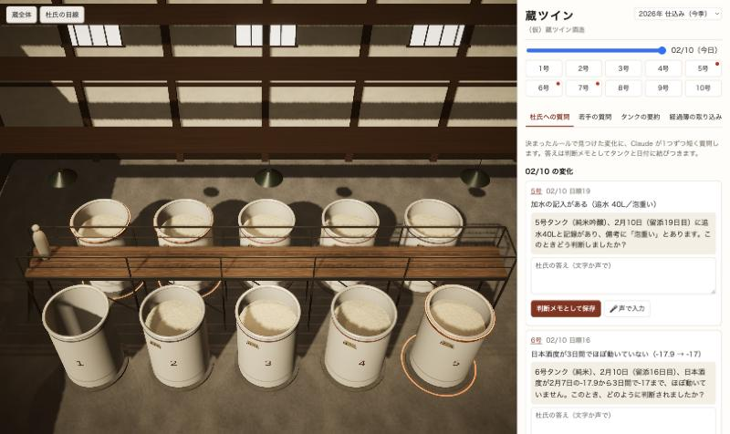

# 蔵ツイン

紙の経過簿の写真から3Dの酒蔵をつくり、杜氏の判断を理由ごとタンクに残して、次の世代へ引き継ぐ。
「Built with Claude: Japan 2026」提出作品です。仕様は [SPEC.md](SPEC.md)。

> このREADMEは作成中です。検証の数字やデモ動画へのリンクは、提出までに書き足します。



## できること

- **経過簿の取り込み**：手書きの醪経過表の写真（またはExcel）を Claude が読み取ります。自信のない欄は拡大して読み直し、それでも分からない欄だけを「要確認」にします。
- **杜氏への質問**：変化（品温の上げ下げ・追水・日本酒度の停滞）はプログラムのルールで検知します。Claude は、その変化について判断を聞く開いた質問を1つだけ作ります。
- **若手の質問**：過去の判断メモと経過簿だけを根拠に Claude が答え、別の Claude が一文ずつ記録と照合します。根拠のない文は削り、記録に無ければ「記録が見つかりません」と答えます。
- **3Dの蔵**（Unity 6・URP・WebGL）：日付に合わせて液面と品温の帯が動き、変化のあったタンクの縁と足元が控えめに光ります。杜氏の目線でタンクを覗き込めます。

設計の原則：Claude は醸造の判断をしません。最終判断は常に杜氏です。蔵の入力は増やしません。

## 構成

| 場所 | 中身 |
|---|---|
| `web/` | 操作画面（Vite＋素のJS）、Netlify Functions（Claude API はサーバー側だけで呼ぶ）、デモデータ、検知ルール |
| `unity/KuraTwin/` | 3Dの蔵。`Kura` メニュー（またはバッチ実行）でシーンを組み立て、WebGL で `web/public/unity/` に書き出す |
| `docs/screenshots/` | 作り直す前と後の画面 |
| `print/` | 手書き用の経過簿の用紙（PDF） |

## 動かし方

```bash
cd web
npm install
cp .env.example .env   # ANTHROPIC_API_KEY を書く
npm run dev            # http://localhost:8888
npm test
```

## 杜氏のキャラクター（Tripo で生成）

3Dの蔵に立つ杜氏は、[Tripo](https://www.tripo3d.ai/) の API で、**文章だけから生成**しました（実在の人物の写真は使っていません）。

- 生成：文章から3D（`v3.1-20260211`、テクスチャ付き・ポリゴンを抑える）
- 骨入れ：Tripo の自動リグ（人型、`v1.0-20240301`）
- 動き：Tripo の「立って待つ」「うなずく」。うなずきは Unity 側で首と頭だけに効かせ、話している間だけ重ねます
- 手順：[`web/scripts/tripo/toji.mjs`](web/scripts/tripo/toji.mjs)

**モデルのファイル（FBX・画像）はこのリポジトリに含めていません**（`unity/KuraTwin/Assets/Toji/` は `.gitignore` 済み）。
自分で作り直すときは、`web/.env` に `TRIPO_API_KEY` を書き、`web/` で次を順に実行してから、Unity の `Kura/1. シーンを用意` を実行します。
モデルが無い場合、杜氏は仮の人形のまま表示されます。

```bash
node --env-file=.env scripts/tripo/toji.mjs generate
node --env-file=.env scripts/tripo/toji.mjs rigcheck
node --env-file=.env scripts/tripo/toji.mjs rig
node --env-file=.env scripts/tripo/toji.mjs animate
```

公開している Web 版の3D（`web/public/unity/`）には、生成した杜氏が含まれます。

## データについて

デモの蔵・経過簿・判断メモはすべて架空です。実在の蔵のデータは含みません。

## Claude Code の使い方

この作品は Claude Code と一緒に作りました。[CLAUDE.md](CLAUDE.md) に設計の原則とAPIキーの扱いを書き、フックで APIキー（Anthropic・Tripo）を含むコミットを止めています。経過簿の用語は Skill（`.claude/skills/kura-terms`）にまとめています。
